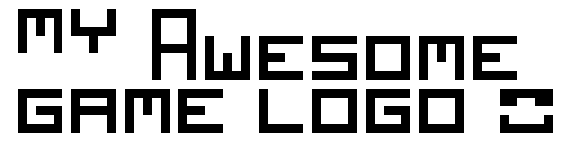

---

_NOTICE:_

---




$(Game description)

[Game Trailer](https://link)
[YouTube Gameplayhttps://](link)
[itch.io Release](https://link)
[Steam Release](https://link)

## Build dependencies

### Windows

You must install [MSYS2](https://www.msys2.org/) and launch **UCRT64** console in order to install dependencies and build the project:
```
pacman -S mingw-w64-ucrt-x86_64-gcc \
    mingw-w64-ucrt-x86_64-cmake mingw-w64-ucrt-x86_64-ninja
```

Also you can optionally install raylib:
```
pacman -S mingw-w64-ucrt-x86_64-raylib
```

### Linux

#### Arch

```
pacman -S
```

Also you can optionally install raylib:
```
pacman -S
```

#### Ubuntu

```
apt install
```

Also you can optionally install raylib:
```
apt install
```

#### Fedora

```
dnf install
```

Also you can optionally install raylib:
```
dnf install
```

#### NixOS

```
nix-shell
```

### MacOS

```
brew install
```

Also you can optionally install raylib:
```
brew install
```

## Build instructions

To build the project on any platform:
```
make build
```

To run the project on any platform:
```
make run
```

To view build options:
```
make help
```

## Libraries and other assets used

- [Raylib](https://github.com/raysan5/raylib): Zlib
- [$(Dependency)](https://link): $(License)
- [$(Dependency)](https://link): $(License)
- [$(Dependency)](https://link): $(License)

## Controls

| Key | Action |
|-----|--------|
| $(Key) | $(Action) |
| $(Key) | $(Action) |
| $(Key) | $(Action) |

## Developers

- [$(Developer)](https://link) - $(Role/Tasks developed)
- [$(Developer)](https://link) - $(Role/Tasks developed)
- [$(Developer)](https://link) - $(Role/Tasks developed)
